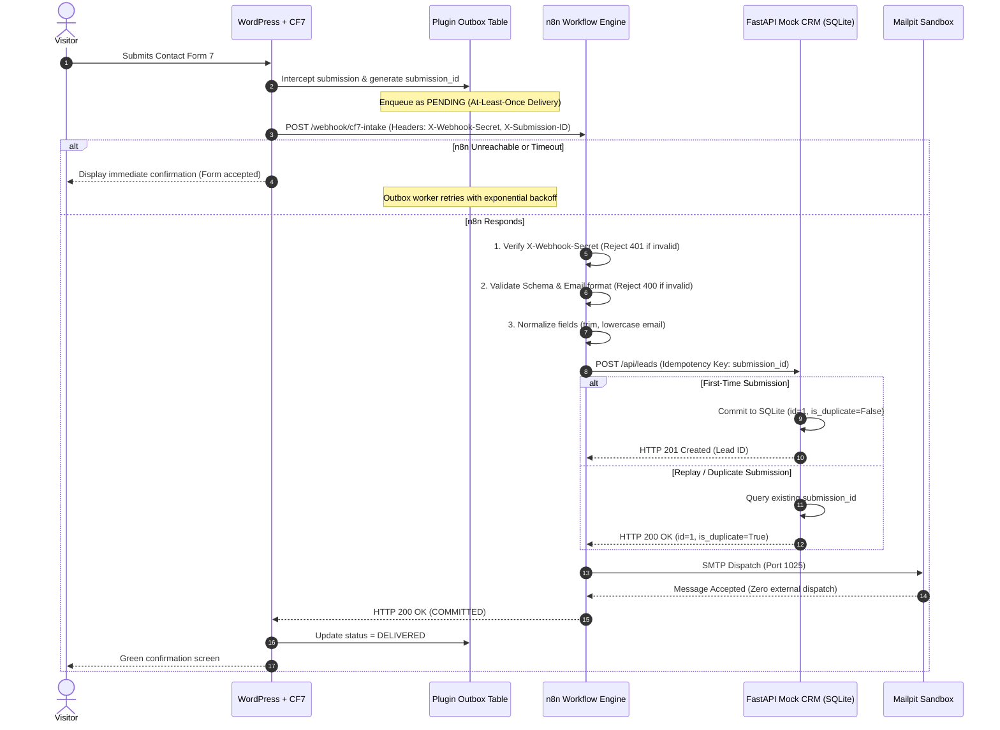
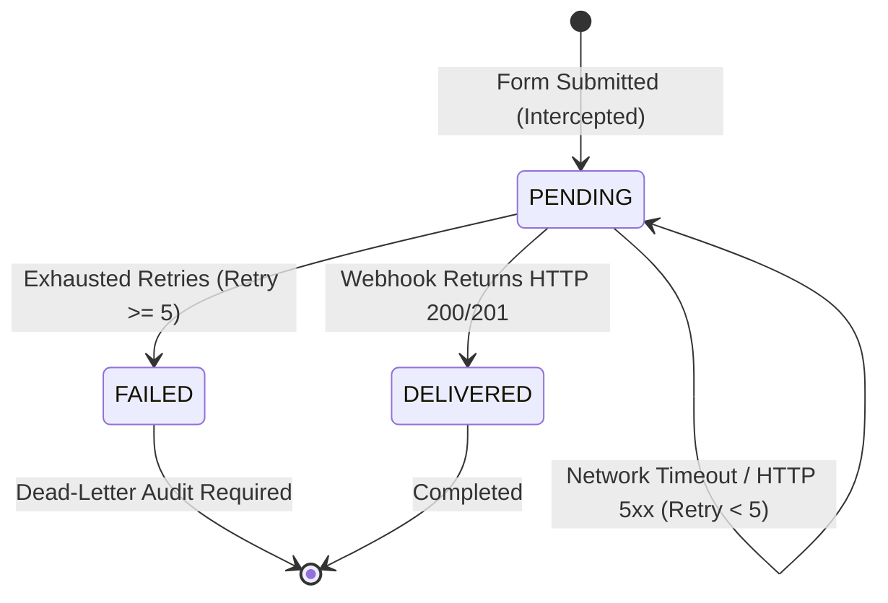

# System Architecture & Technical Specifications — PORTFOLIO-024

**Project:** WordPress Contact Form 7 → n8n → Mock CRM Integration Lab  
**Classification:** Independent Local Technical Reference Implementation  
**Data Policy:** 100% Synthetic Demonstration Data | Zero External Leakage  

---

## 1. System Overview

The integration lab solves the fragility of traditional webhook-based form integrations by introducing two critical reliability layers:
1. **The Client-Side Durable Outbox (WordPress):** Guarantees at-least-once delivery from WordPress even during network timeouts, downstream maintenance, or n8n restarts.
2. **The Server-Side Idempotency Gate (Mock CRM):** Guarantees exactly-once persistence using deterministic submission keys, neutralizing duplicate records caused by client retries or rapid re-submits.

---

## 2. Sequence Diagram: Normal & Resilient Flow



---

## 3. Outbox State Machine

The custom WordPress plugin implements an outbox queue state machine:



### Outbox Database Schema (`wp_cf7_n8n_outbox`):
```sql
CREATE TABLE wp_cf7_n8n_outbox (
    id BIGINT(20) UNSIGNED NOT NULL AUTO_INCREMENT,
    submission_id VARCHAR(128) NOT NULL,
    payload LONGTEXT NOT NULL,
    status VARCHAR(32) NOT NULL DEFAULT 'PENDING',
    retry_count INT(11) NOT NULL DEFAULT 0,
    last_error TEXT NULL,
    created_at DATETIME NOT NULL,
    updated_at DATETIME NOT NULL,
    PRIMARY KEY (id),
    UNIQUE KEY uk_submission_id (submission_id),
    KEY idx_status (status)
);
```

---

## 4. Mock CRM Database Schema (`leads` table in SQLite):

```sql
CREATE TABLE leads (
    id INTEGER PRIMARY KEY AUTOINCREMENT,
    submission_id TEXT UNIQUE NOT NULL,
    full_name TEXT NOT NULL,
    email TEXT NOT NULL,
    phone TEXT,
    company TEXT,
    service_required TEXT NOT NULL,
    message TEXT NOT NULL,
    created_at TEXT NOT NULL
);

CREATE INDEX idx_leads_submission_id ON leads(submission_id);
CREATE INDEX idx_leads_email ON leads(email);
```

---

## 5. Security & Isolation Architecture

1. **Network Boundary:** All container ports (`8080`, `5678`, `8000`, `8025`, `1025`) are bound exclusively to loopback interface `127.0.0.1`. No public Cloudflare tunnels or external reverse proxies are attached.
2. **Mutual Secret Authentication:** Webhooks require an explicit `X-Webhook-Secret` header matching the pre-shared token.
3. **PII Masking:** Console logs mask email user identifiers (`j***@example.com`) and phone numbers to prevent log aggregation leaks.
4. **Local Email Sandbox:** Mailpit intercepts all outbound email notifications internally; zero SMTP traffic escapes to external MX records.
