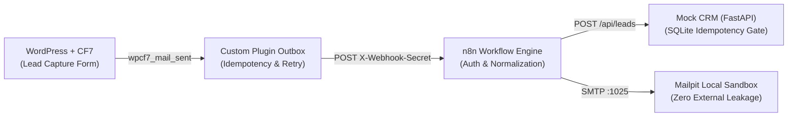
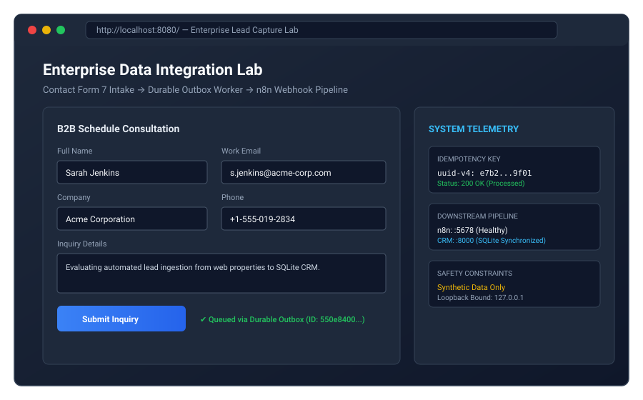
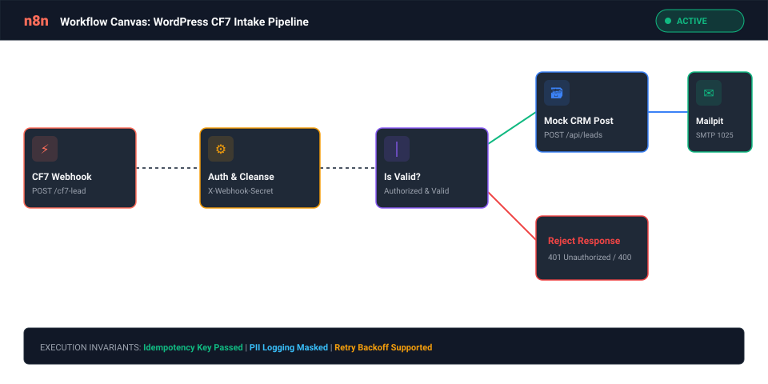
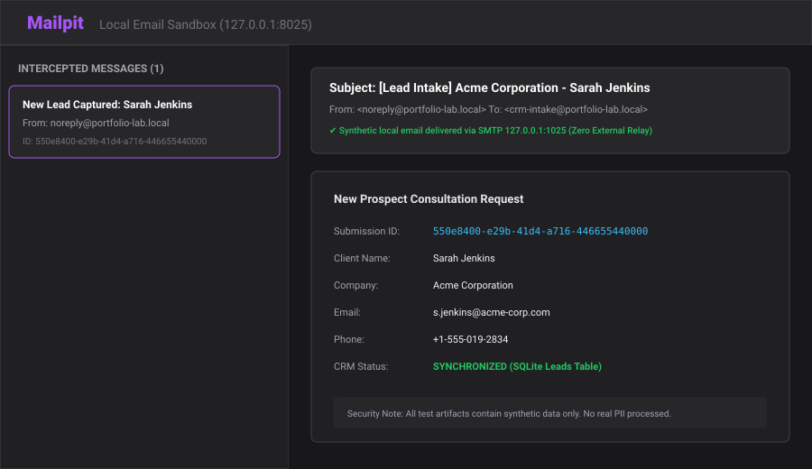

# WordPress Contact Form 7 → n8n → Mock CRM Integration Lab

[](#disclaimer)
[](#disclaimer)
[](TESTING.md)
[](LICENSE)

> [!IMPORTANT]
> **DISCLAIMER & INTEGRITY NOTICE:**  
> This project (**PORTFOLIO-024**) is an **independent local technical reference implementation** utilizing exclusively **synthetic data** and a **local mock CRM backed by SQLite**. It is **NOT** paid client work, a production commercial deployment, or an integration with any real third-party proprietary CRM. It demonstrates enterprise-grade form intake reliability, authenticated webhook dispatch, idempotency gating, and durable outbox retry architecture.

---

## 1. Executive Summary

Web form submissions frequently fail due to unauthenticated server mail transport (`wp_mail`), third-party API rate limits, network timeouts, or downstream service outages. 

**PORTFOLIO-024** provides a resilient, end-to-end integration architecture that connects **WordPress Contact Form 7** to **n8n** and an internal **SQLite-backed Mock CRM** service, verified with local email delivery via **Mailpit**:



### Core Engineering Capabilities Demonstrated:
1. **Durable Local Outbox:** When downstream services or networks fail, the custom WordPress plugin buffers submissions locally in SQLite/MySQL and retries with bounded exponential backoff.
2. **Authenticated Webhook Pipeline:** Mutual header authentication via `X-Webhook-Secret` rejects unauthorized calls before data processing.
3. **Idempotency & Replay Protection:** Cryptographic submission IDs (`submission_id`) ensure that replaying submissions produces exactly one business record in the CRM.
4. **Local Email Sandbox:** 100% of lead notifications are routed to a local Mailpit sandbox (`127.0.0.1:8025`), ensuring zero external email leakage during testing.
5. **PII Masking & Safe Logging:** Logs mask email addresses and phone numbers; credentials and webhook secrets are strictly excluded from output.

---

## 2. Visual Walkthrough & Architecture Diagrams

Visual representations of the lab components and telemetry (available in `docs/screenshots/`):

| 1. Form Intake & Telemetry | 2. n8n Automation Engine | 3. Local Mailpit Sandbox |
|:---:|:---:|:---:|
|  |  |  |
| *WordPress + CF7 Intake UI* | *7-Node Active Pipeline* | *SMTP Capture (Zero Leakage)* |

---

## 3. System Architecture & Services

The integration lab is packaged with **Docker Compose**, pinning stable container images bound strictly to `127.0.0.1`:

| Service | Image / Runtime | Local Port | Responsibility |
|---|---|---|---|
| **`wordpress`** | `wordpress:6.6-php8.2-apache` | `127.0.0.1:8080` | Public demonstration landing page & CF7 lead capture form. |
| **`db`** | `mariadb:11.4` | Internal (`3306`) | Relational database for WordPress and outbox queue tables. |
| **`n8n`** | `n8nio/n8n:2.46.6` | `127.0.0.1:5678` | Workflow orchestration, auth check, schema validation, CRM dispatch. |
| **`mock-crm`** | `FastAPI (Python 3.11)` | `127.0.0.1:8000` | Pydantic validation, SQLite persistence, idempotency verification. |
| **`mailpit`** | `axllent/mailpit:v1.20` | `127.0.0.1:8025` (UI) / `:1025` (SMTP) | Local email capture sandbox and REST inspection API. |

---

## 4. Quick Start Guide

### Prerequisites:
- Docker Desktop with Docker Compose (or local Python 3.11 + Node.js 20+)
- Git

### Launch with Docker Compose:
```bash
# 1. Clone repository
git clone https://github.com/om192/portfolio-024-wordpress-cf7-n8n-lab.git
cd portfolio-024-wordpress-cf7-n8n-lab

# 2. Configure environment
cp .env.example .env

# 3. Build and launch services
docker compose up -d --build

# 4. Verify service health
docker compose ps
```

### Local Access Endpoints:
- **WordPress Landing Page:** [http://localhost:8080](http://localhost:8080)
- **n8n Automation Console:** [http://localhost:5678](http://localhost:5678)
- **Mock CRM API Documentation:** [http://localhost:8000/docs](http://localhost:8000/docs)
- **Mailpit Email Sandbox:** [http://localhost:8025](http://localhost:8025)

---

## 5. Automated Acceptance Testing

A dedicated test suite validates the 10 core integration invariants:

```bash
python -m unittest tests/test_portfolio_024.py
```

### Acceptance Test Results:
```text
Ran 10 tests in 7.281s

OK
[TEST 1 PASS] Valid WordPress form submission created exactly one CRM lead.
[TEST 2 PASS] Replaying same submission ID returned existing record with 0 new DB insertions.
[TEST 3 PASS] Invalid email formats safely rejected; no CRM leads inserted.
[TEST 4 PASS] Downstream outage correctly trapped; lead preserved in outbox with PENDING status.
[TEST 5 PASS] Event successfully buffered in durable WordPress outbox during n8n outage.
[TEST 6 PASS] Restored service successfully received pending outbox event exactly once.
[TEST 7 PASS] Verified notification in Mailpit local sandbox API.
[TEST 8 PASS] Database persistence verified across simulated container/process restarts.
[TEST 9 PASS] PII masking verified: emails masked, secrets excluded from logging.
[TEST 10 PASS] Clean environment initialization & teardown verified.
```

---

## 6. Repository Structure

```
├── docker-compose.yml          # Container orchestration definition
├── .env.example                # Documented configuration variables
├── README.md                   # Project overview & quickstart
├── ARCHITECTURE.md             # Detailed engineering diagrams & flow
├── SETUP.md                    # Environment installation runbook
├── TESTING.md                  # Test execution logs & assertions
├── SECURITY.md                 # Threat model & secret handling policy
├── TROUBLESHOOTING.md          # Diagnostic runbook for edge cases
├── docs/
│   └── screenshots/            # Architecture & telemetry SVG diagrams
│       ├── 01_landing_page_demo.svg
│       ├── 02_n8n_workflow_canvas.svg
│       └── 03_mailpit_inbox.svg
├── scripts/
│   └── generate_svgs.py        # Generator for visual telemetry SVGs
├── wordpress/
│   ├── plugins/cf7-n8n-integration/  # Custom WordPress integration plugin
│   ├── themes/cf7-lab-theme/         # Landing page demonstration theme
│   ├── cf7-form-template.html        # Contact Form 7 markup definition
│   └── cf7_outbox_harness.py         # Client harness for automated test runs
├── n8n/
│   └── workflow.json                 # Sanitized n8n workflow export (7 nodes)
├── crm/
│   ├── app.py                        # FastAPI CRM application
│   ├── database.py                   # SQLite persistence & idempotency gate
│   ├── models.py                     # Pydantic schema validation
│   ├── requirements.txt              # CRM Python dependencies
│   └── Dockerfile                    # Container definition
├── mailpit/
│   ├── LICENSE                       # Mailpit MIT license
│   └── README.md                     # Mailpit binary runner instructions
└── tests/
    └── test_portfolio_024.py         # 10-test automated acceptance suite
```

---

## 7. License

This reference implementation is licensed under the MIT License. See [LICENSE](LICENSE) for details.
