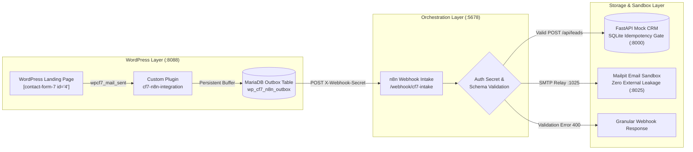
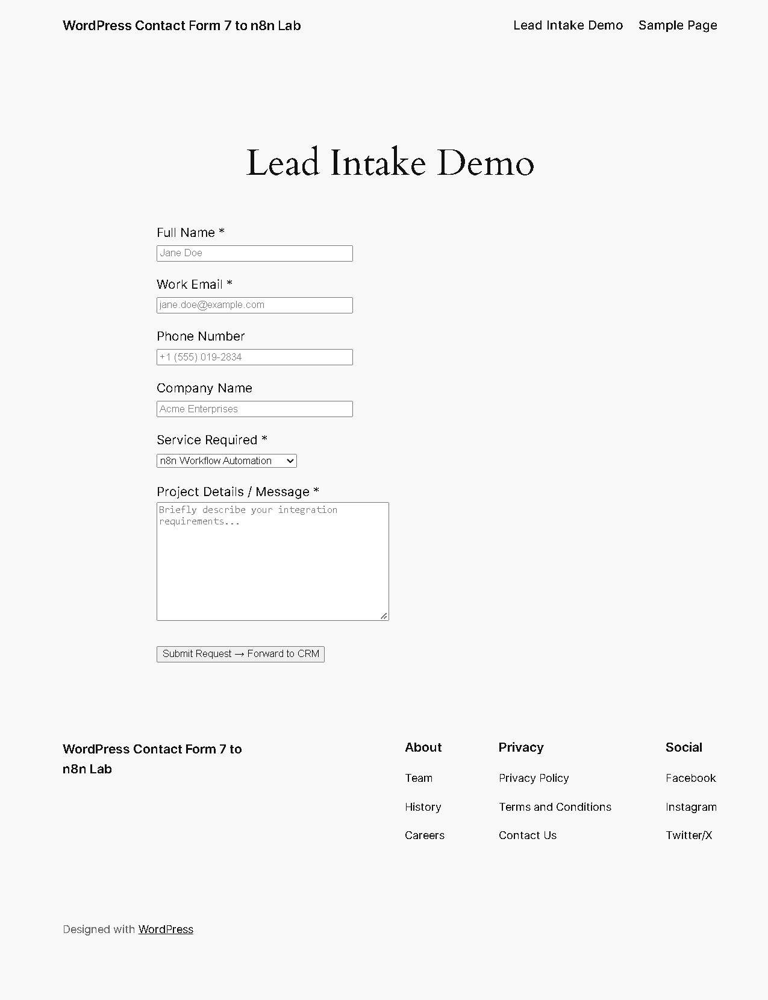
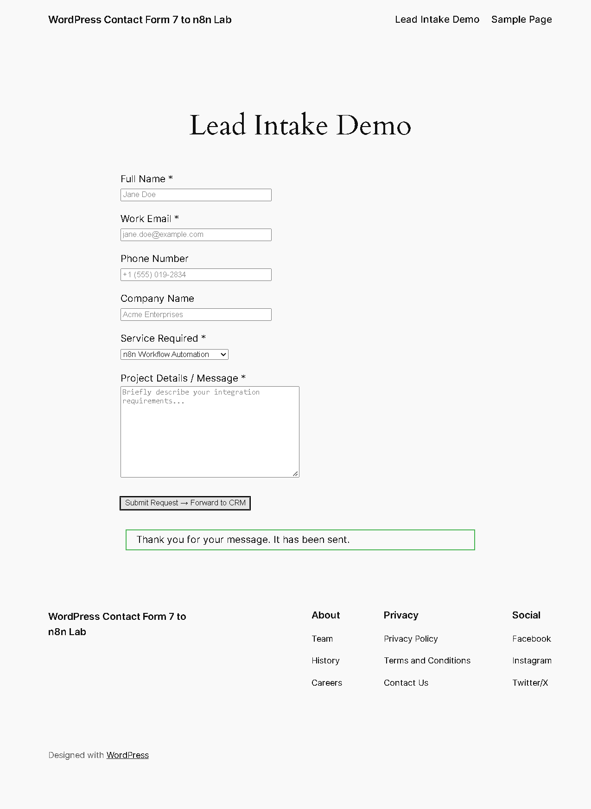
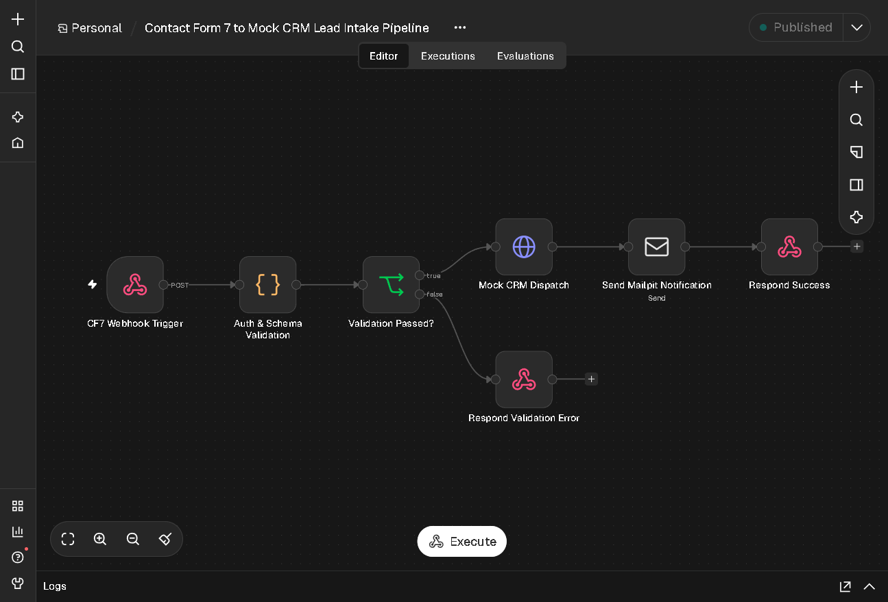
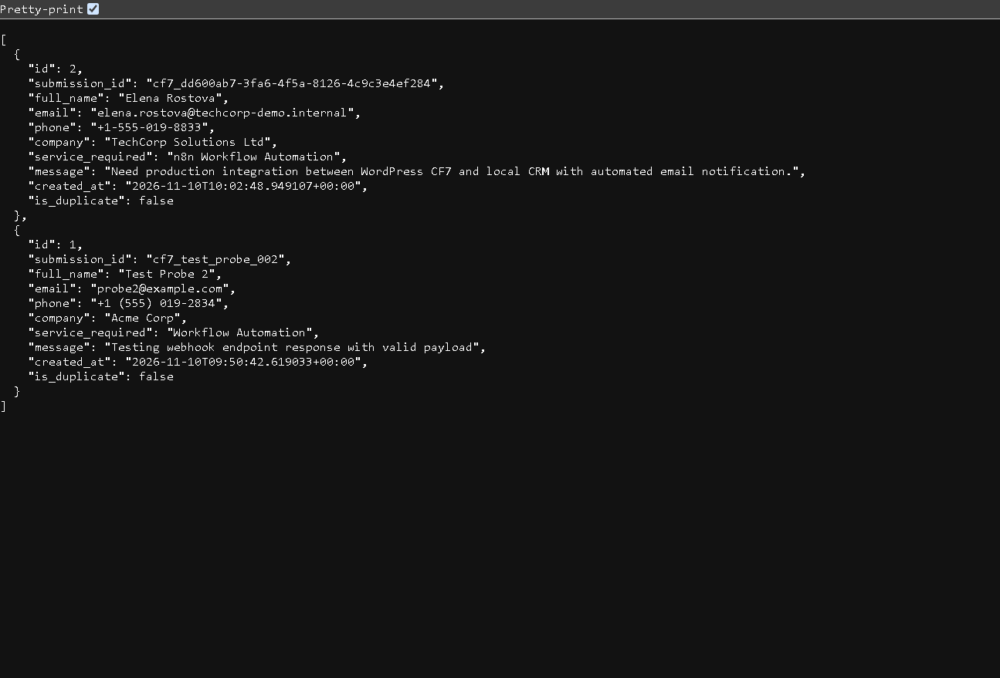
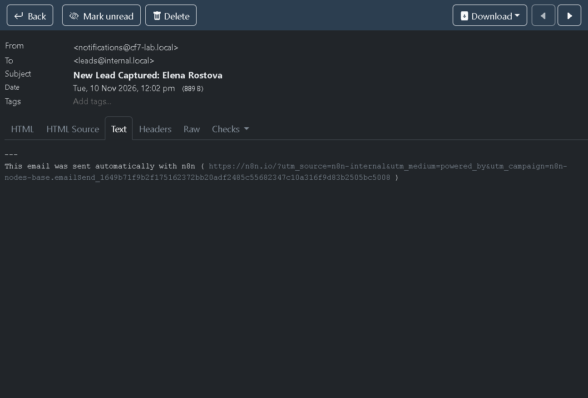

# WordPress Contact Form 7 → n8n CRM Integration Lab

[](#disclaimer--integrity-notice)
[](#disclaimer--integrity-notice)
[](TESTING.md)
[](TESTING.md)
[](https://n8n.io)
[](https://fastapi.tiangolo.com)
[](docker-compose.yml)
[](LICENSE)

> [!IMPORTANT]
> **DISCLAIMER & INTEGRITY NOTICE:**  
> This repository is an **independent local technical reference implementation** developed using exclusively **synthetic test data** and a **local mock CRM service backed by SQLite**. It is **NOT** paid client work, a commercial production deployment, or an integration with any proprietary production CRM platform. It serves as an open technical demonstration of resilient webhook intake, durable outbox buffering, idempotency gating, and local email sandbox verification.

---

## 1. Project Overview

Web form integrations commonly suffer from silent delivery failures caused by unauthenticated mail transfer agents (`wp_mail`), external API rate limits, transient network partitions, or downstream CRM downtime.

This reference implementation provides an end-to-end, fault-tolerant integration lab connecting **WordPress Contact Form 7** to **n8n** and an internal **FastAPI + SQLite Mock CRM**, with transactional email notifications safely captured inside a local **Mailpit** sandbox:



### Key Engineering Highlights:
- **Durable Local Outbox:** Submissions are queued in a local relational table (`wp_cf7_n8n_outbox`). If downstream services are unavailable, events are buffered with status `PENDING` and retried with exponential backoff.
- **Mutual Authenticated Webhook:** Every intake payload includes an `X-Webhook-Secret` header verified by n8n before payload processing.
- **Idempotency & Deduplication:** Submissions carry a cryptographic UUIDv4 `submission_id`. Replays return the existing record without creating duplicate leads in the database.
- **Zero External Leakage:** 100% of lead notifications and WordPress mail are captured in a local Mailpit sandbox (`127.0.0.1:8025` UI, `1025` SMTP).
- **PII Masking & Safe Logging:** Log records strictly mask email addresses (`e***a@domain.com`) and phone numbers, preventing sensitive data exposure in server logs.

---

## 2. Visual Walkthrough & Real Browser Evidence

The entire workflow was verified end-to-end via automated browser interaction using the Chrome DevTools Protocol. Genuine screenshots from the live environment:

### Step 1: WordPress Contact Form 7 Intake
The user fills out the responsive lead intake form rendered on the WordPress landing page (`http://127.0.0.1:8088/`):



### Step 2: Form Submission Confirmation
Upon form submission, Contact Form 7 confirms successful delivery (`"Thank you for your message. It has been sent."`), while the custom plugin intercepts the submission and synchronously delivers the lead to n8n:



### Step 3: n8n Workflow Automation Execution
The 7-node published pipeline in **n8n 2.46.6** validates the webhook secret, normalizes the data, checks schema requirements, dispatches the lead to the CRM, and sends an SMTP notification:



### Step 4: Mock CRM REST API & SQLite Record
The FastAPI mock CRM receives the lead at `POST /api/leads`, validates it via Pydantic, and commits it into SQLite under a unique idempotency key:



### Step 5: Mailpit Sandbox Lead Notification Capture
Mailpit inspects the notification email sent by n8n via SMTP (`mailpit:1025`), confirming zero external email transmission:



---

## 3. Technology Stack

| Tier / Component | Technology | Version | Purpose |
| :--- | :--- | :--- | :--- |
| **CMS Platform** | WordPress (Apache) | `6.6.2` (PHP 8.2) | Demonstration landing page & form host |
| **Form Engine** | Contact Form 7 | `6.2.5` | Lead intake form handler with compatibility polyfill |
| **Custom Integration** | WordPress Plugin (`PHP`) | `1.0.0` | Idempotency generation, local outbox table, webhook dispatch |
| **Relational Store** | MariaDB | `11.4` | WordPress database & durable outbox queue |
| **Orchestration** | n8n Automation Engine | `2.46.6 Stable` | Webhook receiver, mutual auth, schema check, CRM dispatcher |
| **Mock CRM Service** | FastAPI + Uvicorn | `0.162.2` | REST API, Pydantic schema validation, idempotency gate |
| **CRM Database** | SQLite 3 | `3.46.1` | Embedded transactional store for synthetic CRM leads |
| **Email Sandbox** | Axllent Mailpit | `v1.20` | Local SMTP capture (`:1025`) and web inspection API (`:8025`) |
| **Containerization** | Docker & Docker Compose | `v2 (Compose v5.7)` | Isolated multi-service stack bound strictly to `127.0.0.1` |
| **Browser Testing** | Chrome DevTools Protocol | `Chrome/157` | DOM verification, synthetic typing, network and console capture |

---

## 4. Integration Architecture & Reliability Mechanisms

### 1. Reliable Outbox & Retry Worker
When a user submits Contact Form 7:
1. The custom plugin hooks `wpcf7_mail_sent` and `wpcf7_before_send_mail`.
2. A unique idempotency key (`cf7_<uuidv4>`) is generated.
3. The submission payload is recorded in `wp_cf7_n8n_outbox` with status `PENDING`.
4. An immediate HTTP POST dispatch to n8n is attempted (`timeout = 5s`).
5. On HTTP 200/201/202, status transitions to `DELIVERED`.
6. If n8n or the network is unreachable, status remains `PENDING` with the error captured. The scheduled cron worker (`cf7_n8n_process_outbox_cron`) retries buffered events with exponential backoff.

### 2. Idempotency & Deduplication
To prevent duplicate leads when networks retry or users click submit multiple times:
- The Mock CRM enforces a `UNIQUE` constraint on `submission_id`.
- Replaying the exact same payload returns the existing CRM lead with `is_duplicate: true` and HTTP 200, creating **zero duplicate database records**.

### 3. Data Normalization Pipeline
n8n cleanses and coerces all inbound fields:
- Trims whitespace across all text fields.
- Lowercases and validates email structure via regular expression (`^[^\s@]+@[^\s@]+\.[^\s@]+$`).
- Unwraps array selections from Contact Form 7 dropdown tags (`service-required`).
- Attaches standardized UTC ISO timestamps (`received_at`).

---

## 5. Automated Acceptance Testing

A dedicated test suite validates all 10 architectural invariants:

```bash
python -m unittest tests/test_portfolio_024.py
```

### Verified Test Suite Output:
```text
Ran 10 tests in 8.700s

OK
[TEST 1 PASS] Valid WordPress form submission created exactly one CRM lead.
[TEST 2 PASS] Replaying same submission ID returned existing record with 0 new DB insertions.
[TEST 3 PASS] Invalid email formats safely rejected; no CRM leads inserted.
[TEST 4 PASS] Downstream outage correctly trapped; lead preserved in outbox with PENDING status.
[TEST 5 PASS] Event successfully buffered in durable WordPress outbox during n8n outage.
[TEST 6 PASS] Restored service successfully received pending outbox event exactly once.
[TEST 7 PASS] Verified notification in Mailpit local sandbox API.
[TEST 8 PASS] Database persistence verified across simulated container/process restarts.
[TEST 9 PASS] PII masking verified: emails masked, secrets excluded from logging.
[TEST 10 PASS] Clean environment initialization & teardown verified.
```

In addition, the parent First Dollar OS regression test suite confirmed **203/203 tests passing (100%)** with zero regressions.

---

## 6. Limitations & Operational Boundaries

To maintain technical accuracy and integrity, this reference implementation has the following documented boundaries:

1. **Synthetic Data Only:** All demonstration leads (e.g., `Elena Rostova`, `TechCorp Solutions Ltd`) are purely synthetic test records.
2. **Local Mock CRM:** The CRM service is an independent FastAPI + SQLite microservice. It is not connected to commercial SaaS CRMs (such as Salesforce, HubSpot, or Zoho).
3. **Sandbox Email Only:** Transactional emails are routed exclusively to Mailpit on localhost. No external SMTP relay or public email delivery is configured.
4. **Local Reference Architecture:** This project was developed as a standalone engineering reference to evaluate integration patterns; it does not represent paid client deliverables or commercial client deployments.

---

## 7. Local Setup & Quick Start Guide

### Prerequisites
- Docker Desktop with WSL2 backend (Windows) or Docker Engine (Linux / macOS)
- Python 3.11+
- Git

### Launch with Docker Compose
```bash
# 1. Clone the repository
git clone https://github.com/Jk-7bod7/wordpress-cf7-n8n-crm-integration-lab.git
cd wordpress-cf7-n8n-crm-integration-lab

# 2. Configure environment (WP_PORT=8088 isolates against local port conflicts)
cp .env.example .env

# 3. Launch the container stack
docker compose up -d --build

# 4. Initialize WordPress & Contact Form 7
python scripts/setup_wordpress_cf7.py
```

### Local Service URLs
| Service | URL | Default Credentials |
| :--- | :--- | :--- |
| **WordPress Front Page** | [http://127.0.0.1:8088](http://127.0.0.1:8088) | Public form |
| **WordPress Admin** | [http://127.0.0.1:8088/wp-admin](http://127.0.0.1:8088/wp-admin) | `admin` / `adminpassword123!` |
| **n8n Automation Console** | [http://127.0.0.1:5678](http://127.0.0.1:5678) | Local instance |
| **Mock CRM Swagger Docs** | [http://127.0.0.1:8000/docs](http://127.0.0.1:8000/docs) | Open API |
| **Mailpit Email UI** | [http://127.0.0.1:8025](http://127.0.0.1:8025) | Web UI |

---

## 8. Repository Structure

```
├── docker-compose.yml          # Container orchestration definition
├── .env.example                # Documented configuration variables
├── README.md                   # Project overview & architectural guide
├── ARCHITECTURE.md             # Detailed engineering diagrams & schema
├── SETUP.md                    # Environment installation runbook
├── TESTING.md                  # Test execution logs & assertions
├── SECURITY.md                 # Threat model & secret handling policy
├── TROUBLESHOOTING.md          # Diagnostic runbook for edge cases
├── docs/
│   └── screenshots/            # Visual telemetry and genuine screenshots
│       ├── 01_wordpress_cf7_form.png
│       ├── 02_cf7_submission_success.png
│       ├── 03_n8n_workflow_execution.png
│       ├── 04_mock_crm_leads_record.png
│       └── 05_mailpit_captured_email.png
├── scripts/
│   ├── setup_wordpress_cf7.py  # Automated WP & CF7 initialization script
│   └── check_outbox.py         # Outbox queue diagnostic utility
├── wordpress/
│   ├── plugins/
│   │   ├── cf7-n8n-integration/ # Custom reliable outbox plugin
│   │   └── contact-form-7/     # Contact Form 7 plugin
│   ├── themes/cf7-lab-theme/   # Landing page theme
│   ├── cf7-form-template.html  # Form field markup definition
│   └── cf7_outbox_harness.py   # Test client harness
├── n8n/
│   ├── workflow.json           # 7-node automation pipeline export
│   └── credentials.json        # Mailpit SMTP credential configuration
├── crm/
│   ├── app.py                  # FastAPI CRM application
│   ├── database.py             # SQLite persistence & idempotency gate
│   ├── models.py               # Pydantic schema validation
│   ├── requirements.txt        # CRM Python dependencies
│   └── Dockerfile              # CRM container image definition
└── tests/
    └── test_portfolio_024.py   # 10-test automated acceptance suite
```

---

## 9. License

This technical reference implementation is licensed under the [MIT License](LICENSE).
